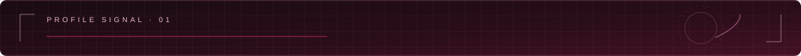
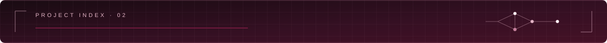
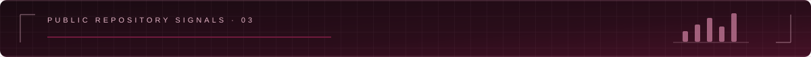
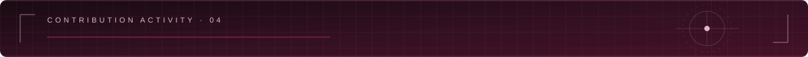

  

  <a href="https://github.com/DarkShadow04">GitHub profile</a>
  &nbsp;·&nbsp;
  <a href="https://cybergodoo7.wordpress.com/">Website</a>

  

  

  

## About

Penetration Tester and Cyber Security researcher with a passion for security architecture, SOC, Red Team activity. Seeks opportunity to reach new cybersecurity standards and achieve operational goals.

  

## Selected projects

| Project | Description |
| --- | --- |
| [ShadowNexus](https://github.com/DarkShadow04/ShadowNexus) | Website management framework for hosting, workspaces, tunnels, diagnostics, and recovery. |
| [Nmap Auto V2](https://github.com/DarkShadow04/Nmap_Auto_V2) | Nmap scanning automation with reporting options. |
| [Dark Console](https://github.com/DarkShadow04/Dark_Console) | VirusTotal analysis script. |
| [AbuseLPDB](https://github.com/DarkShadow04/AbuseLPDB) | Scans IP addresses through the AbuseLPDB API and writes results to a file. |
| [Security Header Checker](https://github.com/DarkShadow04/sec-head) | Checks for missing security headers and provides solutions. |

  

## GitHub stats and most used languages

  
  

Stats and language cards use public repositories. The card service is best-effort and may occasionally rate-limit requests.

  

## GitHub contributions

Live contribution calendar for [DarkShadow04](https://github.com/DarkShadow04), rendered from public GitHub activity. No totals, rankings, or streak claims are added.

  

  

